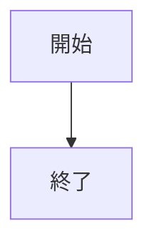

# このリポジトリでの作業

Vivliostyle で技術書を作るためのテンプレートです。同じ原稿から PDF と EPUB を作れます。PDF の既定の判型は A5 です。原稿は `manuscript/`、画像などの素材は `assets/` に置きます。

## インストール時

1. Node.js 24 以上（推奨）、または Node.js 22.13 以上の 22 系と npm を用意し、`npm ci` と `npx playwright install chromium-headless-shell` を実行する。
2. `vivliostyle.config.js` の `title`、`author`、必要に応じて判型の `size` を本に合わせて変更する。
3. `npm run build` と `npm run check:pdf` で通常版 PDF を確認する。EPUB は `npm run build:epub` と `npm run check:epub` で生成・検証し、`output/epub/book.epub` を対象のリーダーで開いて確認する。
4. EPUB の検証には公式の EPUBCheck を導入する。Ubuntu・WSL は `epubcheck` パッケージ、ほかの環境は `epubcheck` コマンドか Java と `EPUBCHECK_JAR`（公式 JAR のパス）を使う。詳細は README を参照する。
5. 印刷用 PDF が必要な場合だけ、Ghostscript と `pdffonts`・`pdfinfo` をインストールして `npm run build:print` を実行する。Windows では各コマンドを PATH に追加する。Ubuntu や WSL では `ghostscript` と `poppler-utils` を使う。

## 原稿を追加するとき

1. `manuscript/` に Markdown ファイルを作る。章の順番が分かる名前を付ける。
2. `vivliostyle.config.js` の `entry` にファイルパスを読ませたい順に追加する。目次はここから生成される。
3. 画像、表、数式、言語指定のコードブロック、Mermaid 図を使える。Mermaid は原稿の `mermaid` コードブロックに直接書く。
4. `npm run lint` で日本語の文章を確認し、`npm run build` と `npm run check:pdf`、`npm run build:epub` と `npm run check:epub` を実行する。必要に応じて `npm run preview` で PDF の改ページや図表の配置を確認する。EPUB はリフロー形式なので、対象リーダーで目次・日本語・図表・数式の表示も確認する。EPUB 専用の本文は `epub.css`、表紙は `epub-cover.css` で体裁を調整する。数式は MathJax の TeX 字体による SVG に変換され、本文用の Noto Sans JP とコード用の Noto Sans Mono・配色 CSS が同梱される。`npm run check:epub:render -- output/epub/book.epub output/epub-render` で全ページを幅 600px・360px の画像にして目視確認できる。
5. 全形式を作る場合は `npm run build:all` を使う。通常版 PDF、印刷用 PDF、EPUB を生成するため、印刷用ツールも必要。生成後に `npm run check:pdf -- output/pdf/book.pdf output/pdf/book_print.pdf` と `npm run check:epub` を実行する。Docker では `npm run build:docker` がビルドと両形式の検証を行う。

### 記法の最小例

#### 画像の場合

~~~markdown

~~~

#### 表の場合

~~~markdown
| 項目 | 値 |
| :--- | ---: |
| 件数 | 3 |
~~~

#### 数式の場合

~~~markdown
$x^2-3x+2=0$

$$
x^2-3x+2=0
$$
~~~

#### コードブロックの場合

~~~markdown
```python
print("Hello, world!")
```
~~~

#### Mermaid 図の場合

~~~markdown

~~~

## 画像を追加するとき

1. 画像を `assets/` に置き、内容が分かるファイル名を付ける。
2. 原稿から `` の形式で参照する。代替テキストには図の内容を書く。
   表紙・裏表紙の SVG は EPUB ビルド時に PNG へ自動変換する。編集するのは元の SVG とし、生成先の `assets/epub-generated/` は編集・コミットしない。
3. `npm run build` で参照切れやページからのはみ出しがないか確認する。印刷用 PDF を作る場合は、グレースケールで図が読めるかも確認する。EPUB ではリーダーの文字サイズや画面幅を変えて画像や表の表示を確認する。

生成物の `output/` と `.vivliostyle/`、依存関係の `node_modules/` は編集・コミットしない。

## ソースコードを変更するとき

[`DEVELOPMENT.md`](DEVELOPMENT.md) の lint 環境を有効にして `npm run lint:code` と `npm test` を実行し、同ガイドのビルド・描画検証も確認する。厳格な lint は `scripts/` の実装・既存テストの JavaScript とシェルだけを対象にする。ルート設定・CSS・原稿・コード例・素材・生成物へ対象を広げない。原稿校正の `npm run lint` は別に維持する。
