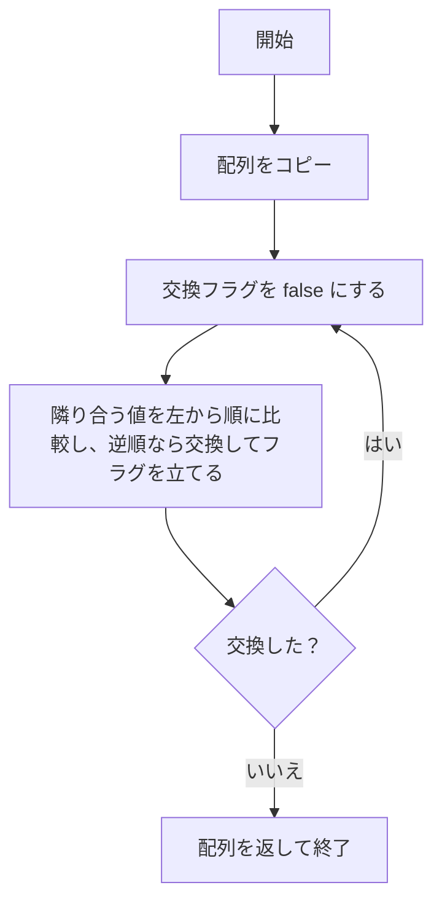
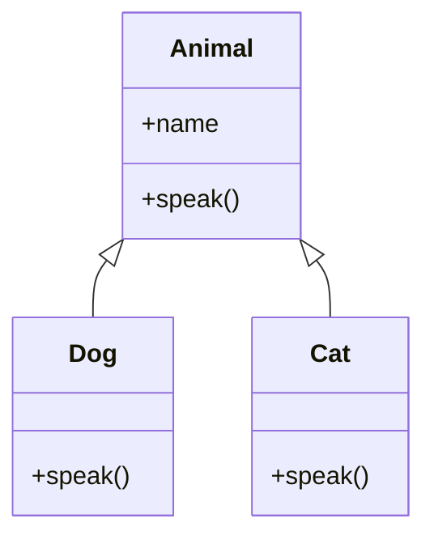

# 原稿の書き方サンプル

この章は、画像、コード、数式、フローチャート、クラス図を原稿に入れる例です。`manuscript/` の Markdown から `../assets/` のファイルを参照します。

## 画像

画像も同じ記法で挿入します。代替テキストには画像の内容を書きます。


## Python のコード

コードブロックに言語名を付けると、ソースコードとして組版されます。

```python
def bubble_sort(values):
    items = values.copy()
    while True:
        swapped = False
        for j in range(len(items) - 1):
            if items[j] > items[j + 1]:
                left = items[j]
                items[j] = items[j + 1]
                items[j + 1] = left
                swapped = True
        if not swapped:
            return items


print(bubble_sort([3, 1, 2]))  # [1, 2, 3]
```
## 数式

二次方程式 $x^2-3x+2=0$ を因数分解して解きます。途中の式は行をそろえて書けます。

$$
\begin{aligned}
x^2-3x+2 &= 0 \\
x^2-x-2x+2 &= 0 \\
x(x-1)-2(x-1) &= 0 \\
(x-1)(x-2) &= 0
\end{aligned}
$$

したがって、$x=1$ または $x=2$ です。同じ答えを解の公式でも確かめます。

$$
x=\frac{-b\pm\sqrt{b^2-4ac}}{2a}
$$

この方程式では $a=1$、$b=-3$、$c=2$ です。公式に代入すると、

$$
\begin{aligned}
x &= \frac{-(-3)\pm\sqrt{(-3)^2-4\cdot1\cdot2}}{2\cdot1} \\
  &= \frac{3\pm\sqrt{1}}{2} \\
  &= \frac{3\pm1}{2}
\end{aligned}
$$

よって、$x=\frac{3+1}{2}=2$ または $x=\frac{3-1}{2}=1$ と求まります。
## バブルソートのフローチャート

フローチャートも Markdown の `mermaid` コードブロックに直接書きます。フローは上から下へ進み、交換がなくなるまで繰り返します。


## Mermaid のクラス図

Markdown の `mermaid` コードブロックに図を直接書く例です。`Dog` と `Cat` は `Animal` を継承します。


